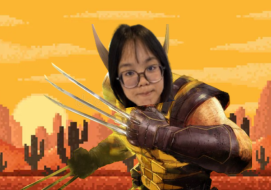
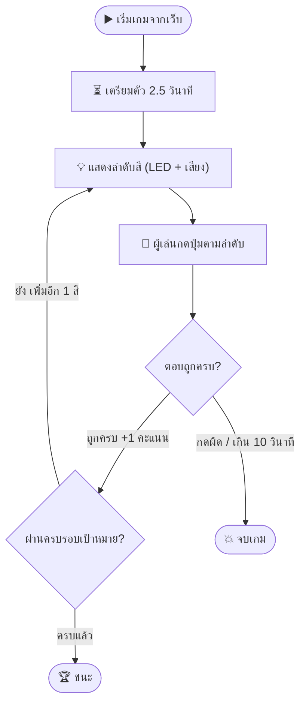
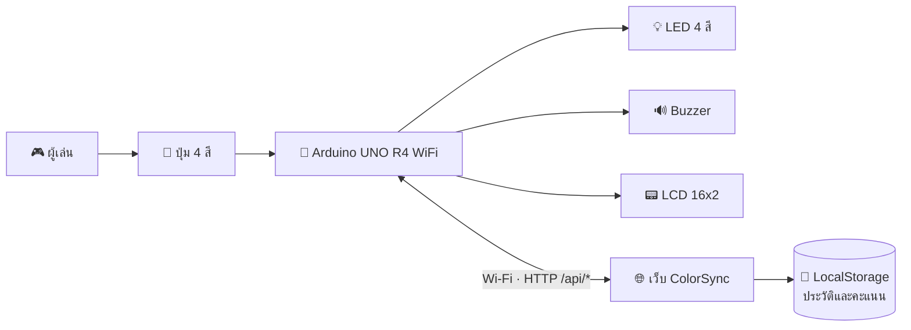

<div align="center">

# 🎨 ColorSync

### เกมจดจำลำดับสี เล่นได้ทั้งบนบอร์ด Arduino จริงและบนหน้าเว็บ


Physical Computing 2026 - IT KMITL [คณะเทคโนโลยีสารสนเทศ สจล.]

</div>

---

## 🔗 ลิงก์โครงงาน

| รายการ | ลิงก์ |
|---|---|
| เว็บไซต์โครงงาน | วางลิงก์ที่นี่ |
| คลิปสาธิต (YouTube) | วางลิงก์ที่นี่ |
| โปสเตอร์ | วางลิงก์ที่นี่ |
| Source Code | https://github.com/BunyaphonCh/ColorSync |

---

## 👥 สมาชิกในกลุ่ม

|  |  |  |  |
| :---: | :---: | :---: | :---: |
| 68070039<br>ณัชชา ธรรมเอกภาพ | 68070042<br>ณัฐฐาพร มานะธำรง | 68070092<br>บุญสิตา นามบุญเรือง | 68070093<br>บุณยาพร ชัยมงคลทรัพย์ |

---

## 📝 บทคัดย่อ (Abstract)

ColorSync เป็นเกมจดจำลำดับสีที่พัฒนาด้วยไมโครคอนโทรลเลอร์ Arduino UNO R4 WiFi ร่วมกับเว็บไซต์ ระบบแสดงลำดับสีด้วย LED และเสียงจาก Buzzer จากนั้นผู้เล่นกดปุ่มตามลำดับที่เห็น เมื่อตอบถูกครบจะได้ 1 คะแนนและเพิ่มสีหนึ่งตำแหน่งในรอบถัดไป เกมสิ้นสุดเมื่อกดผิด หมดเวลาตอบ หรือผ่านครบทุกรอบ

เกมมีความเร็ว 4 ระดับ จำนวนรอบ 5, 7, 10 และ 15 รอบตามลำดับ จอ LCD แสดงสถานะและผลการเล่น ส่วนเว็บไซต์ใช้กรอกชื่อ เลือกความเร็ว เริ่มเกม และดูคะแนน โดยบอร์ดให้บริการหน้าเว็บผ่านเครือข่าย Wi-Fi เดียวกัน ระบบบันทึกประวัติในเบราว์เซอร์และรองรับการแข่งขันแบบผลัดกันเล่นสองคนด้วยความเร็วและลำดับสีเดียวกัน

<details>
<summary>🇬🇧 English abstract</summary>

ColorSync is a sequence-memory game built with an Arduino UNO R4 WiFi and a web interface. LEDs and a buzzer present a color sequence, and players repeat it using physical buttons. Each completed round earns one point and adds one color to the next round. Four difficulty levels offer targets of 5, 7, 10, and 15 rounds. An LCD displays game status and results. The board serves a local website for player names, difficulty selection, game controls, and scores. Browser storage keeps play history, while a two-player mode compares results using the same difficulty and sequence. A browser-only demo is also available.

</details>

---

## 🎯 วัตถุประสงค์

1. ฝึกการสังเกต การจดจ่อ และการจดจำลำดับสีผ่านเกม
2. สร้างความสนุกและความท้าทาย ทำลายสถิติของตัวเอง หรือผลัดกันแข่งกับเพื่อน
3. พัฒนาเกมบนไมโครคอนโทรลเลอร์ที่เชื่อมต่อเว็บไซต์ผ่าน Wi-Fi เพื่อตั้งค่า แสดงผล และติดตามประวัติคะแนน

---

## ✨ จุดเด่น

| | |
|---|---|
| 🎮 **เล่นได้สองแบบ** | เล่นกับบอร์ดจริง หรือทดลองกดบนหน้าเว็บ |
| ⚡ **4 ระดับความเร็ว** | ไฟกระพริบช้าไปเร็ว ผ่านครบ 5, 7, 10 หรือ 15 รอบ |
| ⚔️ **แข่งกับเพื่อน** | ผลัดกันเล่นสองคน ความเร็วและลำดับสีเดียวกัน |
| 🎵 **เสียงแยกตามสี** | Buzzer เสียงต่างกันในแต่ละสี |
| 📊 **ประวัติและอันดับ** | บันทึกคะแนนแยกตามระดับในเบราว์เซอร์ |
| 📱 **ไม่ต้องติดตั้งแอป** | บอร์ดเปิดเว็บเอง แค่ต่อ Wi-Fi เดียวกัน |

---

## 🕹️ วิธีเล่น

1. เปิดเว็บไซต์และกรอกชื่อเล่น
2. เลือกระดับความเร็วแล้วกดเริ่มเกม
3. สังเกตและจดจำลำดับไฟที่แสดง (พร้อมเสียง)
4. รอให้แสดงครบ แล้วกดปุ่มตามลำดับที่เห็น
5. ตอบถูกครบ รับ 1 คะแนน และรอบถัดไปเพิ่มอีก 1 สี
6. กดผิดหรือหมดเวลาตอบ เกมจบและแสดงคะแนน
7. แข่งกับเพื่อน: ผลัดกันเล่นด้วยความเร็วเดียวกัน แล้วเทียบคะแนน

### ⏱️ ระดับความเร็ว

| ระดับ | ไฟติด | ช่วงเว้น | ผ่านครบ |
|:---:|:---:|:---:|:---:|
| 1 | 600 ms | 250 ms | 5 รอบ |
| 2 | 350 ms | 150 ms | 7 รอบ |
| 3 | 180 ms | 100 ms | 10 รอบ |
| 4 | 90 ms | 70 ms | 15 รอบ |

### 🔄 ขั้นตอนของเกม



---

## 🧩 ภาพรวมระบบ



### 🌐 HTTP API ของบอร์ด

| Endpoint | หน้าที่ |
|---|---|
| `/api/status` | อ่านสถานะเกม รอบ คะแนน และแผนไฟของรอบนั้น |
| `/api/start` | เริ่มเกมพร้อมระดับความเร็ว |
| `/api/stop` | หยุดเกมรอบนี้ |
| `/api/config` | ตั้งค่าระดับความเร็ว |

---

## 🔧 อุปกรณ์ที่ใช้

| อุปกรณ์ | จำนวน | หน้าที่ |
|---|---:|---|
| Arduino UNO R4 WiFi | 1 | ควบคุมเกมและให้บริการเว็บ |
| LED แดง เหลือง เขียว น้ำเงิน | 4 | แสดงลำดับสี |
| Push Button | 4 | รับคำตอบจากผู้เล่น |
| Passive Buzzer | 1 | เล่นเสียงแต่ละสีและแจ้งผล |
| LCD 16×2 พร้อม I2C | 1 | แสดงสถานะ คะแนน และมาสคอต |
| ตัวต้านทาน (ต่อ LED) | 4 | จำกัดกระแส |
| Breadboard / สาย Jumper / USB | 1 ชุด | ต่อวงจร จ่ายไฟ และอัปโหลดโค้ด |

### 📍 การต่อขา

| สี | LED | ปุ่ม |
|---|:---:|:---:|
| 🔴 แดง | D2 | D3 |
| 🟡 เหลือง | D4 | D5 |
| 🟢 เขียว | D6 | D7 |
| 🔵 น้ำเงิน | D8 | D9 |

| อุปกรณ์ | ขา |
|---|---|
| 🔊 Passive Buzzer | D12 |
| 📟 LCD I2C | SDA → A4, SCL → A5 (address `0x27`) |

> ⚠️ LED แต่ละดวงต้องผ่านตัวต้านทาน ปุ่มต่ออีกด้านลง GND (ใช้ `INPUT_PULLUP`) และทุกอุปกรณ์ใช้ GND ร่วมกัน

🔌 ดูวงจรบน Tinkercad : [เปิดวงจร](https://www.tinkercad.com/things/2wu03ZS3m4u-colorsync?sharecode=mYjgGoa_ks1IYr0TxCbiik7tNFAy5ATq_sFLlS413-0)

---

## 💻 Source Code

| ไฟล์ | คำอธิบาย |
|---|---|
| [`firmware/ColorSync/ColorSync.ino`](firmware/ColorSync/ColorSync.ino) | เฟิร์มแวร์บอร์ด : สุ่มลำดับ ตรวจคำตอบ คุม LED/Buzzer/LCD และให้บริการเว็บ |
| [`firmware/ColorSync/web_assets.h`](firmware/ColorSync/web_assets.h) | เว็บที่ถูกบีบอัดและฝังในบอร์ด (สร้างจาก `pack-web.py` ห้ามแก้ตรง ๆ) |
| [`firmware/ColorSync/secrets.example.h`](firmware/ColorSync/secrets.example.h) | ตัวอย่างไฟล์ตั้งค่า Wi-Fi |
| [`dist/`](dist/) | หน้าเว็บ : `index.html`, `styles.css`, `app.js` และไฟล์อื่น ๆ |
| [`scripts/pack-web.py`](scripts/pack-web.py) | ฝังเว็บลงเฟิร์มแวร์ |
| [`scripts/build-pages.py`](scripts/build-pages.py) | สร้างโฟลเดอร์ `docs/` สำหรับ GitHub Pages |
| [`tests/`](tests/) | เทสต์การซิงก์ไฟระหว่างบอร์ดกับเว็บ |

### 📚 ไลบรารีที่ใช้

- `WiFiS3` (มากับบอร์ด UNO R4 WiFi)
- `Wire`
- `LiquidCrystal_I2C`
- `ArduinoJson`
- ฝั่งเว็บ: HTML · CSS · JavaScript · LocalStorage (ไม่ใช้เฟรมเวิร์ก)

### 🔬 จุดที่น่าสนใจทางเทคนิค

- **ไม่ใช้ `delay()` ระหว่างเล่น:** ใช้ `millis()` จับเวลาทุกช่วง บอร์ดจึงยังตอบคำขอจากเว็บได้ตลอด
- **ไฟบนเว็บตรงกับบอร์ด : ** บอร์ดส่งตารางเวลาของรอบ (เวลาเริ่ม ไฟติด ช่วงเว้น ลำดับสี) ให้เว็บคำนวณแสงเอง ลดปัญหาจากการดึงสถานะที่ขาดช่วง
- **Debounce ปุ่ม : ** กรองสัญญาณรบกวน 25 ms และนับการกดหลายปุ่มพร้อมกันว่ากดผิด
- **ฝังเว็บในบอร์ด : ** บีบอัดไฟล์เว็บด้วย gzip เก็บใน flash ของ UNO R4 ไม่ต้องใช้ SD card

---

## 🚀 วิธีติดตั้งและใช้งาน

1. ติดตั้งไลบรารี `LiquidCrystal_I2C` และ `ArduinoJson` ใน Arduino IDE
2. คัดลอก `secrets.example.h` เป็น `secrets.h` ในโฟลเดอร์เดียวกัน แล้วใส่ชื่อและรหัส Wi-Fi
3. เปิด `ColorSync.ino` แล้วอัปโหลดลงบอร์ด
4. เปิด Serial Monitor ที่ **115200 baud** เพื่อดู IP ของบอร์ด
5. เปิด `http://IP-ของบอร์ด` ในเบราว์เซอร์ของอุปกรณ์ที่ใช้ Wi-Fi เดียวกัน แล้วเริ่มเล่นได้เลย

> 💡 ถ้าเปิดเว็บจาก Live Server หรือ GitHub Pages จะเชื่อมบอร์ดไม่ได้ ให้ใช้โหมด "ทดลองเล่นบนเว็บ" แทน

### 🛠️ ถ้าแก้หน้าเว็บ

```bash
python3 scripts/pack-web.py      # ฝังเว็บใหม่ลง web_assets.h แล้วอัปโหลดสเก็ตช์อีกครั้ง
python3 scripts/build-pages.py   # สร้าง docs/ สำหรับ GitHub Pages
npm test                         # รันเทสต์
```